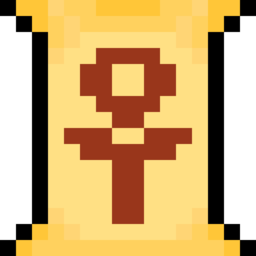

# 🌵 Matheopolis 
Situation d’Apprentissage et d’Évaluation de deuxième année de BUT Informatique. Le projet consiste en la création d'un site web éducatif et ludique dans le cadre des ouvrages Mathéopolis.

## 🤖 Commandes 
**aucune pour le moment**

## 💻 Liste des développeurs 
- Ewan François 
- Aurèle Jambert 
- Lezina Khadissova 
- Nina Matic Charbit 
- Nicolas Moyenin 

## 🖍️ Maquette 
[Voir la maquette Figma](https://www.figma.com/design/n6IRV5iQ6clbGnAHbRVYyb/Matheopolis?node-id=0-1&p=f&t=Uf5wDiDgbD4kr0Cz-0)

## ⚙️ Technologies 

